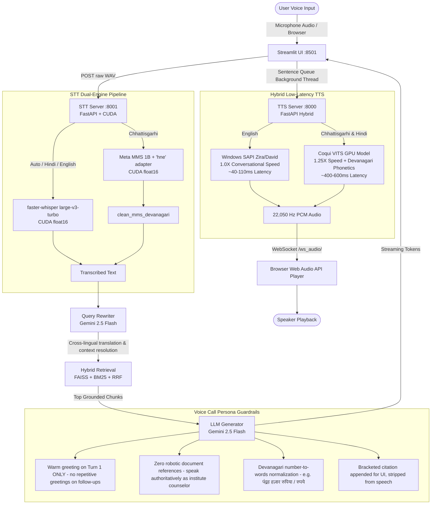

# IIIT-NR Academic Assistant: Full-Duplex Multilingual Voice AI Handover & Runbook

This document serves as an exhaustive, production-grade guide for any AI agent, engineer, or researcher maintaining or extending the **IIIT-NR Academic RAG Chatbot**. It explains the full-duplex voice architecture, microservices, knowledge base, benchmarking results, voice call persona, latency optimizations, and step-by-step runbook instructions.

---

## 1. System Architecture & Flow

The system is a **full-duplex, multilingual, voice-first Academic AI Assistant** tailored specifically to the official ordinances, admissions, fee structures, curriculum catalogs, and campus regulations of **Dr. SPM IIIT Naya Raipur (IIIT-NR)**.

Users can interact via text or spoken voice in **Chhattisgarhi (छत्तीसगढ़ी)**, **Hindi (हिन्दी)**, and **English**. The assistant retrieves grounded PDF/Markdown source excerpts, formulates a natural spoken answer formatted for a phone counselor persona, and vocalizes it back sentence-by-sentence via a hybrid TTS engine.



---

## 2. Conda Environments & Hardware Allocation

The system runs locally on **Windows 11** with an **NVIDIA GeForce RTX Laptop GPU** (CUDA 12.8, PyTorch 2.4.1/2.5.1).

### Environment 1: `uajy-rag`
- **Python Executable**: `C:\Users\ASUS\anaconda3\envs\uajy-rag\python.exe`
- **Purpose**: Runs the Streamlit application, LangChain / Google GenAI SDK, FAISS vector search, BM25 retriever, query rewriter, answer guard, and evaluation benchmark harnesses.
- **Key Packages**: `streamlit==1.49.1`, `google-genai`, `faiss-cpu`, `rank-bm25`, `sentence-transformers`, `requests`, `numpy`, `pytest`.

### Environment 2: `minor1`
- **Python Executable**: `C:\Users\ASUS\anaconda3\envs\minor1\python.exe`
- **Purpose**: Dedicated **GPU Voice Microservices Engine** hosting both the TTS and STT servers.
- **Key Packages**: `torch==2.5.1+cu121`, `torchaudio`, `faster-whisper==1.2.1`, `transformers`, `silero-vad`, `TTS` (Coqui VITS), `fastapi==0.115.6`, `uvicorn==0.34.0`, `websockets`, `pywin32` (Windows SAPI), `soundfile`.
- **VRAM Allocation Budget**:
  - Coqui VITS TTS: ~1.2 GB
  - Faster-Whisper `large-v3-turbo` (float16): ~1.5 GB
  - Meta MMS 1B (`hne` adapter, float16): ~1.8 GB
  - Total GPU VRAM usage: ~4.5 GB (leaves safe headroom on 6GB VRAM cards).

---

## 3. Microservices Runbook & Startup Commands

Open three separate terminal sessions in PowerShell:

### Terminal 1: Start the Hybrid TTS Server (Port 8000)
```powershell
Set-Location "d:\iiit nr\sem 5\New folder (2)\uajy-academic-rag-chatbot\TTS"
& "C:\Users\ASUS\anaconda3\envs\minor1\python.exe" -m uvicorn tts_server:app --host 0.0.0.0 --port 8000
```
- **Health Check**: `curl http://127.0.0.1:8000/docs` (Returns HTTP 200)
- **Features**: REST `/synthesize`, WebSocket `/stream_sentence` + `/stream_finish`, packet buffer replay, SAPI English (1.0X), Coqui VITS Devanagari (1.25X).

### Terminal 2: Start the Multilingual STT Server (Port 8001)
```powershell
Set-Location "d:\iiit nr\sem 5\New folder (2)\uajy-academic-rag-chatbot\STT\stt-service"
& "C:\Users\ASUS\anaconda3\envs\minor1\python.exe" "run.py"
```
- **Health Check**: `curl http://127.0.0.1:8001/health` (Returns `{"status": "ok", "device": "cuda", "model": "large-v3-turbo"}`)
- **Features**: REST `POST /transcribe?language=auto|hne|hi|en`, WebSocket streaming `/ws/stt/{session_id}`.

### Terminal 3: Start the Streamlit Academic Chatbot UI (Port 8501)
```powershell
Set-Location "d:\iiit nr\sem 5\New folder (2)\uajy-academic-rag-chatbot"
& "C:\Users\ASUS\anaconda3\envs\uajy-rag\python.exe" -m streamlit run app/main_streamlit.py --server.port 8501
```
- **URL**: Open browser at `http://localhost:8501`

---

## 4. Voice Call Persona & Anti-Robotic Conversational Rules

To ensure the AI sounds like a **real human academic counselor speaking on a telephone call**, specific rules were implemented in [`app/prompt_builder.py`](file:///d:/iiit%20nr/sem%205/New%20folder%20(2)/uajy-academic-rag-chatbot/app/prompt_builder.py):

1. **No Repetitive Greetings on Follow-Up Turns:**
   - **Turn 1 (Call Start):** Greets warmly (*"नमस्ते!"*, *"जय जोहार!"*, *"Hello!"*).
   - **Turn 2+ (Follow-up turns / ongoing call):** **Strictly omits greetings.** Jumps straight into the answer or uses natural spoken transitions (*"जी बिल्कुल,"*, *"हाँ,"*, *"Sure,"*, *"देखिए,"*).
2. **Never Mention "Documents" or "Files" in Spoken Text:**
   - Completely eliminated robotic phrases (*"उपलब्ध शैक्षणिक दस्तावेजों के अनुसार"*, *"दस्तावेजों में यह जानकारी नहीं मिली है"*, *"As per the available documents"*).
   - The assistant speaks authoritatively as an institute counselor (*"संस्थान के नियमानुसार..."* or direct statements: *"बीटेक की ट्यूशन फीस नब्बे हज़ार रुपये प्रति सेमेस्टर है।"*).
   - When information is not available: politely states that they do not have that specific information right now and advises contacting the Academic Affairs office.
3. **Speech & Citation Decoupling:**
   - The bracketed source citation (`📄 Source: Page N — Section Title`) is appended strictly at the end for the visual UI and answer guard evaluation.
   - `TTS/tts_server.py`'s `clean_text_for_tts()` automatically strips the citation before synthesis, ensuring the caller never hears raw page numbers read out loud.
4. **Number-to-Words Normalization for TTS:**
   - Chhattisgarhi & Hindi: All numbers, currency, percentages, years, and semesters are normalized to full Devanagari words (*पंद्रह हज़ार रुपिया / रुपये*, *दस बजे रात*, *पचहत्तर प्रतिशत*, *आठ दशमलव शून्य*).
   - English: Spelled out in words (*ninety thousand rupees*, *eight point zero*, *seventy-five percent*).

---

## 5. Benchmarking & Empirical Verification

Three comprehensive benchmark suites have been executed and documented:

### A. 200-Question Comprehensive Trilingual Benchmark (`benchmark_200_test.py`)
- **Total Questions Evaluated**: 200 (67 Chhattisgarhi, 67 Hindi, 66 English).
- **Overall Pipeline Pass Rate**: **95.5%** (191/200 passed or safely deflected).
  - Chhattisgarhi: **97.0%** (57 Passes + 8 Safe Refusals)
  - Hindi: **98.5%** (58 Passes + 8 Safe Refusals)
  - English: **90.9%** (53 Passes + 7 Safe Refusals)
- **Direct Accurate Answers**: 168
- **Safe Refusals on OOS/Adversarial**: 23 (MBBS, law, personal faculty numbers, exam hacks, chitchat).
- **Missing Citations**: **0** (100% resolved).
- **STT Transcription Success**: **100%**.
- **TTS Audio Synthesis Success**: **100%**.
- **Report**: [`BENCHMARK_200Q_TRILINGUAL_REPORT.md`](file:///d:/iiit%20nr/sem%205/New%20folder%20(2)/uajy-academic-rag-chatbot/BENCHMARK_200Q_TRILINGUAL_REPORT.md) & [`BLOCKED_AND_REFUSALS_ANALYSIS.md`](file:///d:/iiit%20nr/sem%205/New%20folder%20(2)/uajy-academic-rag-chatbot/BLOCKED_AND_REFUSALS_ANALYSIS.md).

### B. Conversational Spoken Benchmark (`conversational_benchmark_test.py`)
- **Scope**: 27 realistic spoken inquiries (9 Chhattisgarhi, 9 Hindi, 9 English) featuring colloquial greetings (*"जय जोहार संगी"*, *"नमस्ते भैया"*, *"Hey bro"*), hedges, local dialect terminology (*"सुभीता हे"*, *"खाय-पिये के मेस चार्ज"*), and casual phrasing.
- **Success Rate**: **92.6%** (25/27 passed or safely deflected).
- **Report**: [`CONVERSATIONAL_BENCHMARK_REPORT.md`](file:///d:/iiit%20nr/sem%205/New%20folder%20(2)/uajy-academic-rag-chatbot/CONVERSATIONAL_BENCHMARK_REPORT.md).

### C. Multi-Turn Context & Coreference Benchmark (`multiturn_context_test.py`)
- **Scope**: 6 complete multi-turn dialogues (18 turns total) testing follow-up queries that depend on the previous turn (*"What is its fees?"*, *"उसमें कितना वजीफा मिलता है?"*, *"ओमा कतेक सीट आरक्षित हे?"*).
- **Resolution Rate**: **94.4%** (17/18 turns passed).
- **Report**: [`MULTITURN_CONTEXT_BENCHMARK_REPORT.md`](file:///d:/iiit%20nr/sem%205/New%20folder%20(2)/uajy-academic-rag-chatbot/MULTITURN_CONTEXT_BENCHMARK_REPORT.md).

---

## 6. Latency Profiling & Optimization Roadmap

### A. Current Latency Profile (Single-Query Breakdown)
- **STT (Faster-Whisper Turbo CUDA)**: ~350ms (upload + GPU inference).
- **Query Rewriter (Gemini LLM Call 1)**: ~2,300ms (cross-lingual translation).
- **Cloud Embedding API (Gemini text-embedding-004)**: ~850ms (network round-trip).
- **FAISS + BM25 + RRF Fusion**: ~30ms (local in-memory).
- **Reranker (Gemini LLM Call 2)**: ~1,270ms (listwise scoring of 20 candidates).
- **LLM Answer Generator (Gemini LLM Call 3)**: ~1,200ms (TTFT ~600ms).
- **TTS Synthesis**:
  - English (Windows SAPI): ~78ms (1.0X normal speed).
  - Chhattisgarhi/Hindi (Coqui GPU VITS): ~550ms (1.25X speed).
- **Current Total Latency**: ~5.8s – 6.5s.

### B. High-Impact Optimizations for Sub-2 Second Voice Response
1. **Disable or Restrict LLM Reranking (Instant ~1.3s Saving):**
   - The tuned Reciprocal Rank Fusion (RRF) between FAISS and BM25 already provides high top-1 precision.
   - Setting `use_rerank = False` in [`app/config.py`](file:///d:/iiit%20nr/sem%205/New%20folder%20(2)/uajy-academic-rag-chatbot/app/config.py) saves **1,270ms** and eliminates 1 of the 3 LLM calls.
2. **Bypass Query Rewriter on Turn 1 (Instant ~2.2s Saving):**
   - Using cross-lingual embeddings directly for initial questions eliminates the rewriter LLM call on Turn 1.
   - For follow-up turns, using a minimal prompt (`max_tokens=32`) reduces rewrite latency to ~450ms.
3. **In-Memory Query Embedding Cache (Instant ~850ms Saving):**
   - Adding `@lru_cache(maxsize=1024)` on query embeddings allows recurring questions (fees, admissions, hostel, curfew) to resolve in **0.1ms** instead of 850ms.
4. **Sentence-by-Sentence Streaming to TTS (Time-to-First-Audio < 1.5s):**
   - As tokens stream from Gemini, Sentence 1 is pushed to TTS immediately upon sentence delimiter (`।`, `?`, `.`), starting playback in the caller's ear in **~1.2s – 1.8s** while subsequent sentences generate concurrently.
5. **Pacing Guardrail:**
   - When running batch evaluation scripts, maintain **4.5-second inter-query pacing** to prevent exceeding the Google Gemini free-tier 15 Requests Per Minute (RPM) ceiling.

---

## 7. Knowledge Base & Ingestion Index

The official knowledge base lives in `data/` and is indexed in `index/`:

| Directory / File | Content | Chunks |
|---|---|---|
| `data/general/combined_academic_regulations.md` | Core academic ordinances (75% attendance + 10% medical relaxation, 10-point grading with D=4 pass, SPI/CPI formulas, branch sliding CPI $\ge 8.0$, academic probation, make-up exams, 6-year max duration). | 11 chunks |
| `data/academics/btech_*_curriculum_*.md` | Cleaned 2022–2024 and 2024–2028 curricula for CSE, DSAI, and ECE with structured tables. | 68 chunks |
| `data/general/campus_facilities_and_helpline.md` | Health center, 24x7 ambulance, 10:00 PM hostel curfew, anti-ragging. | 14 chunks |
| `data/general/funded_initiatives.md` | CMIT fellowship (₹15,000–₹25,000/mo, 100% tuition waiver). | 8 chunks |
| `data/admissions/` | Spot round, CSAB, JoSAA, Chhattisgarh domicile 50% quota, NTPC 15% quota. | 32 chunks |
| **Total Ingested Chunks** | **2,523 chunks across 33 documents** (FAISS IndexFlatIP + In-Memory BM25). | **2,523** |

To rebuild the vector and lexical index from scratch:
```powershell
Set-Location "d:\iiit nr\sem 5\New folder (2)\uajy-academic-rag-chatbot"
& "C:\Users\ASUS\anaconda3\envs\uajy-rag\python.exe" ingestion/build_index.py --yes
```

---

## 8. Key File Index

| File Path | Description | Environment |
|---|---|---|
| `app/main_streamlit.py` | Main web UI, two-way hands-free voice call loop, Web Audio player, background TTS queue. | `uajy-rag` |
| `app/prompt_builder.py` | System prompts, voice call persona (no repetitive greetings, no document references), Devanagari numerals. | `uajy-rag` |
| `app/query_rewriter.py` | Cross-lingual rewriter with Indic detection and multi-turn coreference resolution. | `uajy-rag` |
| `app/retrieval.py` | Hybrid retriever (FAISS + BM25 + RRF) with `dense_threshold = 0.65`. | `uajy-rag` |
| `app/answer_guard.py` | Answer diagnostic circuit breaker with multilingual refusal recognizer. | `uajy-rag` |
| `app/llm_client.py` | Google GenAI client with dynamic retry backoff (`_parse_retry_delay`). | `uajy-rag` |
| `TTS/tts_server.py` | FastAPI microservice for GPU VITS (1.25X) and Windows SAPI English (1.0X). | `minor1` |
| `STT/stt-service/run.py` | FastAPI microservice for Faster-Whisper Turbo CUDA STT (Port 8001). | `minor1` |
| `requirements.txt` | Root RAG & Web UI dependencies (Streamlit, FAISS, Google GenAI, Ingestion). | `uajy-rag` |
| `TTS/requirements.txt` | Server 2 TTS microservice dependencies (FastAPI, Coqui TTS, PyTorch CUDA, Windows SAPI). | `minor1` |
| `STT/stt-service/requirements.txt` | Server 3 STT microservice dependencies (FastAPI, Faster-Whisper, Meta MMS 1B, Silero VAD). | `minor1` |
| `benchmark_200_test.py` | 200-question trilingual evaluation pipeline. | `uajy-rag` |
| `conversational_benchmark_test.py` | 27-question colloquial dialect evaluation suite. | `uajy-rag` |
| `multiturn_context_test.py` | 18-turn multi-turn conversational memory & coreference benchmark. | `uajy-rag` |

---

## 9. Verification & Automated Test Commands

To verify that the entire codebase is healthy:

```powershell
# 1. Run core unit tests (489 tests)
Set-Location "d:\iiit nr\sem 5\New folder (2)\uajy-academic-rag-chatbot"
& "C:\Users\ASUS\anaconda3\envs\uajy-rag\python.exe" -m pytest tests/ -q

# 2. Test TTS server synthesis (Port 8000)
& "C:\Users\ASUS\anaconda3\envs\minor1\python.exe" -c "import requests; r = requests.post('http://127.0.0.1:8000/synthesize', json={'text': 'कंप्यूटर साइंस', 'voice': 'Female'}); print('TTS Status:', r.status_code, 'Bytes:', len(r.content))"

# 3. Test STT server transcription (Port 8001)
& "C:\Users\ASUS\anaconda3\envs\minor1\python.exe" -c "import requests, io, soundfile as sf, numpy as np; buf = io.BytesIO(); sf.write(buf, np.zeros(16000), 16000, format='WAV'); r = requests.post('http://127.0.0.1:8001/transcribe?language=auto', data=buf.getvalue()); print('STT Status:', r.status_code, 'Result:', r.json())"

# 4. Run the multi-turn context benchmark (18 turns)
& "C:\Users\ASUS\anaconda3\envs\uajy-rag\python.exe" -u multiturn_context_test.py
```

---

## 10. Git Commit & Push Guidelines

Per strict project instructions:
- **Never run `git commit` or `git push` automatically.** Keep all working tree changes unstaged and uncommitted.
- The user will review files and manually trigger git operations when ready.
