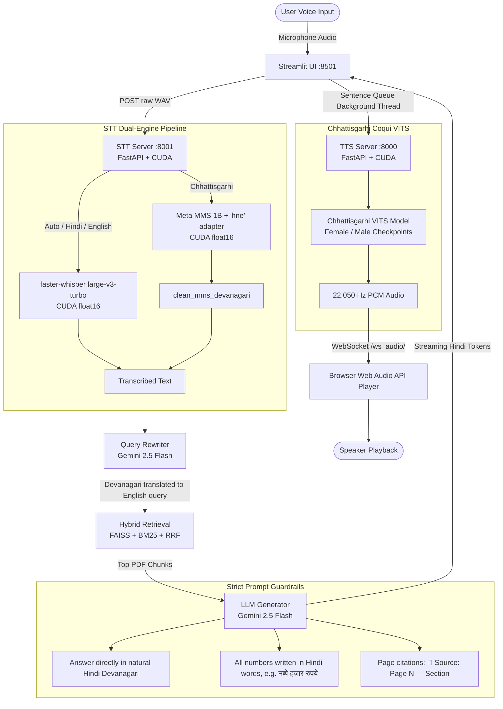

# IIIT-NR Academic Assistant: Full-Duplex Voice AI Handover & Runbook

This document serves as an exhaustive guide for any future AI agent, developer, or researcher continuing work on the **IIIT-NR Academic RAG Chatbot**. It explains the system architecture, what has been implemented, how each microservice works, known pitfalls/fixes, and step-by-step instructions to run the entire system.

---

## 1. System Architecture & Flow

The system is a **full-duplex multimodal Voice AI assistant** tailored for the academic policies, admissions, fees, and curriculum of **Dr. SPM IIIT Naya Raipur**. Users can speak in **Chhattisgarhi**, **Hindi**, or **English**, and the assistant retrieves official PDF excerpts, generates the answer in natural Hindi, and narrate it back using a Chhattisgarhi VITS voice model.



---

## 2. Conda Environments & Hardware Allocation

The host machine is running **Windows 11** with an **NVIDIA GeForce RTX 4050 Laptop GPU** (6GB VRAM, CUDA 12.1).

### Environment 1: `uajy-rag`

- **Python Executable**: `C:\Users\ASUS\anaconda3\envs\uajy-rag\python.exe`
- **Purpose**: Runs the Streamlit web application, LangChain / Google GenAI SDK, FAISS vector search, BM25 retriever, and evaluation pipelines.
- **Key Packages**: `streamlit==1.49.1`, `google-genai`, `faiss-cpu`, `rank-bm25`, `sentence-transformers`, `requests`.

### Environment 2: `minor1`

- **Python Executable**: `C:\Users\ASUS\anaconda3\envs\minor1\python.exe`
- **Purpose**: Dedicated **GPU Voice Engine** (PyTorch with CUDA 12.1) hosting both TTS and STT servers.
- **Key Packages**: `torch==2.5.1+cu121`, `torchaudio==2.5.1+cu121`, `faster-whisper==1.2.1`, `transformers==5.16.1`, `silero-vad==6.2.1`, `TTS` (Coqui), `fastapi==0.115.6`, `uvicorn==0.34.0`, `websockets==14.1`, `soundfile==0.13.0`.
- **VRAM Allocation Budget**:
  - Coqui VITS TTS: ~1.2 GB
  - Faster-Whisper `large-v3-turbo` (float16): ~1.5 GB
  - Meta MMS 1B (`hne` adapter, float16): ~1.8 GB
  - Total GPU VRAM usage: ~4.5 GB / 6.1 GB (Leaves ample headroom).

---

## 3. How to Start Each Server (Step-by-Step Runbook)

Open three separate terminal tabs (PowerShell or Command Prompt).

### Terminal 1: Start the Chhattisgarhi TTS Server (Port 8000)

```powershell
Set-Location "d:\iiit nr\sem 5\New folder (2)\uajy-academic-rag-chatbot"
& "C:\Users\ASUS\anaconda3\envs\minor1\python.exe" "TTS/tts_server.py"
```

- **Endpoint**: `http://127.0.0.1:8000`
- **Health Check**: `curl http://127.0.0.1:8000/health` (Should return `{"status": "ready", "cuda": true}`)
- **Capabilities**: `/synthesize` (REST), `/stream_sentence` + `/ws_audio/{session_id}` (WebSocket streaming).

### Terminal 2: Start the Multilingual STT Server (Port 8001)

```powershell
Set-Location "d:\iiit nr\sem 5\New folder (2)\uajy-academic-rag-chatbot\STT\stt-service"
& "C:\Users\ASUS\anaconda3\envs\minor1\python.exe" "run.py"
```

- **Endpoint**: `http://127.0.0.1:8001`
- **Health Check**: `curl http://127.0.0.1:8001/health` (Should return `{"status": "ok", "device": "cuda", "model": "large-v3-turbo"}`)
- **Capabilities**: `POST /transcribe?language=auto|hne|hi|en` (REST), `/ws/stt/{session_id}` (WebSocket).

### Terminal 3: Start the Streamlit Academic Chatbot UI (Port 8501)

```powershell
Set-Location "d:\iiit nr\sem 5\New folder (2)\uajy-academic-rag-chatbot"
& "C:\Users\ASUS\anaconda3\envs\uajy-rag\python.exe" -m streamlit run app/main_streamlit.py --server.port=8501
```

- **URL**: Open browser at `http://localhost:8501`

---

## 4. Summary of Completed Work

### A. Chhattisgarhi TTS & Low-Latency Streaming

1. **Model Weights**: Coqui VITS models trained on Chhattisgarhi Devanagari text (`female_checkpoint_300000.pth` and `male_checkpoint_300000.pth`, 22,050 Hz, 80 Mels).
2. **GPU Latency**: 7x–27x faster than real-time playback (~0.15s–0.35s per sentence on RTX 4050).
3. **Web Audio API Real-time Streaming**:
   - `TTS/tts_server.py` exposes WebSocket `/ws_audio/{session_id}`.
   - Sentences are synthesized immediately on GPU and dispatched through WebSocket.
   - Browser schedules audio chunks seamlessly back-to-back using Web Audio API `AudioContext`.
1. **Zero-Blocking Streamlit Token Generation**:
   - LLM generation in `app/main_streamlit.py` uses a background `queue.Queue` thread to send sentences to TTS, ensuring token rendering runs at 100% full Gemini speed without pausing.

### B. Speech-to-Text (STT) Multilingual Architecture

1. **Dual Engine in `STT/stt-service/src/asr.py`**:
   - **`FasterWhisperEngine`**: Uses `large-v3-turbo` on CUDA `float16`. Handles English, Hindi, and code-mixed Hinglish with automatic language detection.
   - **`ChhattisgarhiMMSEngine`**: Meta MMS 1B (`facebook/mms-1b-all`) with language-specific adapter `"hne"`.
1. **`clean_mms_devanagari`**: Re-attaches disconnected vowel signs/matras (`\u093e-\u094c`) caused by CTC alignment.
2. **REST Transcribe Route**: Added `POST /transcribe` in `server.py` for direct microphone buffer ingestion.

### C. Cross-Lingual Academic Retrieval

1. **The Problem**: Academic documents in `data/` (curriculum, fee circulars, statutes) are in English.
2. **The Fix in `app/query_rewriter.py`**:
   - Devanagari detection (`re.search(r"[\u0900-\u097F]", query)`) triggers Gemini utility model to translate Chhattisgarhi/Hindi questions into standalone English search queries (`"नवा रायपुर मा बीटेक के फीस कतेक हे"` $\to$ `"What is the B.Tech fee structure in Naya Raipur"`).
   - **Turn 1 Bug Fixed**: Previously, `rewrite_query` skipped execution if `chat_history` was empty. It now correctly translates Devanagari even on turn 1.

### D. Critical Bug Fixes & Guardrails

1. **Whisper "Thank you." Silence Hallucination**:
   - _Cause_: `vad_filter=False` allowed silence/low-level mic noise to reach Whisper's decoder, which defaults to YouTube outro hallucination `"Thank you."`.
   - _Fix_: Enabled Silero VAD (`threshold=0.25`, `speech_pad_ms=250`), dynamic peak normalization (`data / peak * 0.95`), and explicit silence hallucination filtering.
1. **Acoustic Model Dropping Numeric Digits (Fee Queries)**:
   - _Cause_: The VITS phonetic dictionary only contains Devanagari letters (`क-ह`) and vowel signs. ASCII digits (`0-9`) are treated as unknown and discarded.
   - _Fix_: Instructed LLM via prompt to write all numbers as Hindi words (`नब्बे हज़ार रुपये`, `चार वर्ष`). Also added an automatic regex fallback normalizer (`convert_numbers_in_text`) in `TTS/tts_server.py`.
1. **Sentence Fragmenting on Abbreviations**:
   - _Cause_: Sentence regex splitting on period `.` was splitting `डॉ.`, `पी.एच.डी.`, and `एम.टेक.`.
   - _Fix_: Delimiter regex changed strictly to `([।?!\n])`.
1. **Windows CTranslate2 CUDA DLL Loading**:
   - _Cause_: CTranslate2 failed on Windows with `RuntimeError: Library cublas64_12.dll is not found`.
   - _Fix_: Added `os.add_dll_directory(torch_lib)` pointing to PyTorch's `torch/lib` before importing Faster-Whisper.
1. **Git LFS Push to Public Fork**:
   - _Cause_: GitHub rejects large Git LFS binary uploads (>100MB) on public forks without extra billing.
   - _Fix_: Added `*.pth` to `.gitignore`. Model weights remain cached locally in `TTS/chattisgarhi-tts-models/` and `~/.cache/huggingface/`.
1. **Streamlit Browser Mic Delay & Bad Results Fix**:
   - _Cause_: Browser `st.audio_input` sends 44.1/48kHz audio with leading/trailing silence and mouse click spikes (~0.85). Naive peak normalization failed to boost quiet speech, causing Silero VAD to reject it. Faster-Whisper then ran 6-temperature fallback (`[0.0, 0.2, 0.4, 0.6, 0.8, 1.0]`) with `beam_size=5` and mixed Devanagari/English prompts, taking 25+ seconds and hallucinating prompt tokens.
   - _Fix_:
     - **Resample First & 99th-Percentile Normalization**: Resample to 16kHz first, remove DC offset, ignore click spikes using 99th percentile, and boost speech up to 25x to 0.85.
     - **Greedy/Beam 2 Decoding & Capped Temperatures**: Set `beam_size=2` and `temperature=[0.0, 0.2]`, eliminating multi-temperature hangs.
     - **Domain Hotwords**: Replaced mixed prompt with `hotwords`, preventing cross-script hallucination loops.
     - **MMS Silence Trimming**: Meta MMS 1B now trims leading/trailing silence before CTC decoding.
     - **Streamlit Toast Feedback**: Displays `st.toast(...)` showing transcribed text, language, and GPU latency in ms.
1. **Conversational VAD & Turn-Taking Pause Tolerance**:
   - _Cause_: `VAD_MIN_SILENCE_MS` was set to 100ms, `min_silence_duration_ms` in Faster-Whisper was 300ms, and `END_OF_SPEECH_SILENCE_MS` was 600ms. Whenever a speaker paused naturally while formulating a query (e.g. _"I want to know\... [0.5s pause] ...CSE opening rank"_), the VAD immediately treated the pause as an end-of-speech cut, registering only the first clause and discarding or splitting the second clause into an isolated fragment.
   - _Fix_:
     - `min_silence_duration_ms` in Faster-Whisper increased from 300ms to **1,200ms** (with `speech_pad_ms=400` and `threshold=0.18`), preventing natural thinking pauses from fragmenting the sentence.
     - `END_OF_SPEECH_SILENCE_MS` increased from 600ms to **1,400ms** (1.4s), matching natural human conversational rhythms.
     - `VAD_MIN_SILENCE_MS` increased from 100ms to **300ms**, ignoring micro-pauses between consonants.
     - Automatic script-based language mapping: any Devanagari output is cleanly standardized to `hi` instead of regional misdetections.
1. **Audio Inspection & Automatic Disk Logging**:
   - Every audio interaction is automatically logged into `STT/stt-service/logs/audio/`:
     - `{log_id}_raw.wav`: The unmodified original microphone audio recorded from the browser or CLI.
     - `{log_id}_processed.wav`: The 16 kHz resampled, DC-offset-subtracted, and gain-normalized audio fed into the ASR models.
     - `{log_id}_meta.json`: Full diagnostic metadata including latency, SNR, peak, and transcription.
   - Streamlit Voice Inspector: The voice expander displays a side-by-side audio player for both Raw and Processed audio, so users and researchers can immediately listen to and verify audio quality differences.
1. **Client-Side Auto-Stop Voice Activity Detection (VAD)**:
   - _Feature_: In the Streamlit web app, users previously had to manually click the "Stop recording" button after speaking.
   - _Implementation & Lifetime Resilience_:
     - **Top-Window Head Injection**: Injects the master VAD controller script directly into `parentWin.document.head`. This decouples the watcher from Streamlit's ephemeral `components.html` iframes, preventing context destruction and cross-realm errors on reruns.
     - **Hardware WASAPI Re-negotiation Fix**: Uses `track.enabled = false` rather than `track.stop()` during idle periods. Reusing the persistent `MediaStream` prevents Windows audio driver renegotiation locks (`track.muted`) on rapid subsequent questions.
     - **Singleton AudioContext**: Reuses a single persistent `AudioContext` for VAD (`parentWin.__iiitnr_vad_audio_ctx__`) and one for TTS (`parentWin.__iiitnr_tts_audio_ctx__`). Total active contexts never exceed 2, permanently avoiding the Chromium 6-context hardware ceiling.
     - **Continuous Turn-Taking**: State machine smoothly loops (`idle` -> `listening` -> `speaking` -> `silence` -> `stopping` -> `idle`) across infinite questions without page refreshes.
     - Observes `[data-testid="stAudioInputActionButton"][aria-label*="Stop"]` and computes RMS energy at 25 FPS with dynamic noise-floor calibration.
     - Once speech is detected, monitors pause duration. When silence persists for the user-configured cutoff (default: **1.4s**), programmatically invokes `.click()` on the stop button.
     - Displays live animated badge in the UI (Idle: Ready 🟢, Listening 🔵, Speaking 🗣️, Silence countdown ⏳, Auto-stopped ⏹️).
     - Includes safety bounds: 14s initial silence cutoff and 60s max recording guardrail. Manual stop remains 100% accessible anytime.

---

## 5. Key File Index

| File Path                       | Description                                                                                                               | Environment |
| ------------------------------- | ------------------------------------------------------------------------------------------------------------------------- | ----------- |
| `app/main_streamlit.py`         | Main frontend UI, chat loop, voice recording widget (`st.audio_input`), client-side Auto-Stop VAD controller, Web Audio player embedding, and background queue. | `uajy-rag`  |
| `app/prompt_builder.py`         | LLM prompt with strict Hindi output, number-to-words rule, and page citations.                                            | `uajy-rag`  |
| `app/query_rewriter.py`         | Cross-lingual query rewriter (Chhattisgarhi, Hindi, Hinglish -> English search query with few-shots and Indic detection). | `uajy-rag`  |
| `app/retrieval.py`              | Hybrid retriever (FAISS + BM25 + RRF) with Turn 1 cross-lingual rewrite triggers.                                         | `uajy-rag`  |
| `TTS/tts_server.py`             | FastAPI microservice for GPU VITS synthesis and WebSocket audio queueing (Port 8000).                                     | `minor1`    |
| `STT/stt-service/run.py`        | Entry point for STT FastAPI server (Port 8001).                                                                           | `minor1`    |
| `STT/stt-service/src/asr.py`    | Multilingual ASR abstraction (Faster-Whisper Turbo + Meta MMS 1B Chhattisgarhi).                                          | `minor1`    |
| `STT/stt-service/src/server.py` | REST `POST /transcribe` endpoint with peak normalization + WebSocket `/ws/stt/`.                                          | `minor1`    |
| `STT/stt-service/src/config.py` | Central STT configuration, model selection, port 8001, and domain prompt.                                                 | `minor1`    |
| `test_stt_cli.py`               | Terminal CLI debugger for STT: mic recording, live VU meter, audio file test, TTS->STT roundtrip.                         | `minor1`    |

---

## 6. Git Remote & Repository Setup

The primary git remote has been configured for the dedicated IIIT-NR Voice Bot repository:

- **Primary Remote (`origin`)**: `https://github.com/Heux16/iiitnr-voice-bot.git` (Branch: `main`)
- **Legacy Backup Remote (`uajy-origin`)**: `https://github.com/Heux16/uajy-academic-rag-chatbot.git`
- **Push Instruction**: Once the repo `iiitnr-voice-bot` is created on GitHub, publish local commits via:
  ```powershell
  git push -u origin main
  ```

---

## 7. Verification & Automated Test Commands

To verify that the entire codebase remains intact:

```powershell
# 1. Run all 480 core RAG & cross-lingual query rewriter unit tests
Set-Location "d:\iiit nr\sem 5\New folder (2)\uajy-academic-rag-chatbot"
& "C:\Users\ASUS\anaconda3\envs\uajy-rag\python.exe" -m pytest tests/ -q

# 2. Test TTS server synthesis (Port 8000)
& "C:\Users\ASUS\anaconda3\envs\minor1\python.exe" -c "import requests; r = requests.post('http://127.0.0.1:8000/synthesize', json={'text': 'कंप्यूटर साइंस', 'voice': 'Female'}); print('TTS Status:', r.status_code, 'WAV bytes:', len(r.content))"

# 3. Test STT server transcription (Port 8001)
& "C:\Users\ASUS\anaconda3\envs\minor1\python.exe" -c "import requests, io, soundfile as sf, numpy as np; buf = io.BytesIO(); sf.write(buf, np.zeros(16000), 16000, format='WAV'); r = requests.post('http://127.0.0.1:8001/transcribe?language=auto', data=buf.getvalue()); print('STT Status:', r.status_code, 'Result:', r.json())"

# 4. Interactive Terminal STT Debugger (Mic & Roundtrip)
& "C:\Users\ASUS\anaconda3\envs\minor1\python.exe" test_stt_cli.py

# 5. Quick CLI STT Roundtrip checks
& "C:\Users\ASUS\anaconda3\envs\minor1\python.exe" test_stt_cli.py --synth "नवा रायपुर मा फीस कतेक हे" --lang hne
& "C:\Users\ASUS\anaconda3\envs\minor1\python.exe" test_stt_cli.py --synth "कंप्यूटर साइंस में कितनी सीटें हैं" --lang auto
```

---

## 7. Recommended Next Steps for Future AI Agents

1. **Live Browser WebSocket Streaming for Speech Input**:
   - Currently, `st.audio_input` records the user's audio buffer and posts it on completion (`POST /transcribe`).
   - A custom Streamlit component or Web Audio API script can be added to connect directly to `ws://localhost:8001/ws/stt/{session_id}` for **live partial transcription** on screen while the user speaks.
1. **Audio Narration Toggle**:
   - Provide a quick toggle in the chat interface to switch between "Voice + Text" and "Text Only" mode.
1. **External Model Weight Hosting**:
   - If sharing the repository publicly, create a script (`scripts/download_models.py`) to download the ~950MB VITS `.pth` weights from Hugging Face or Google Drive into `TTS/chattisgarhi-tts-models/`.
