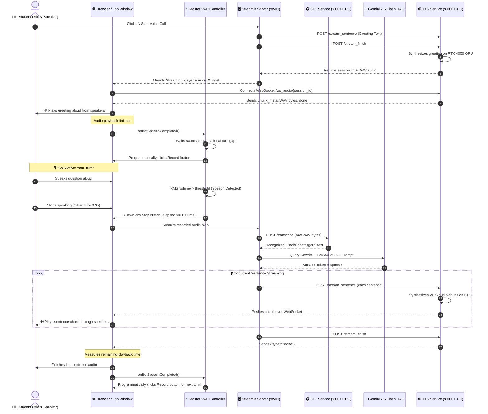
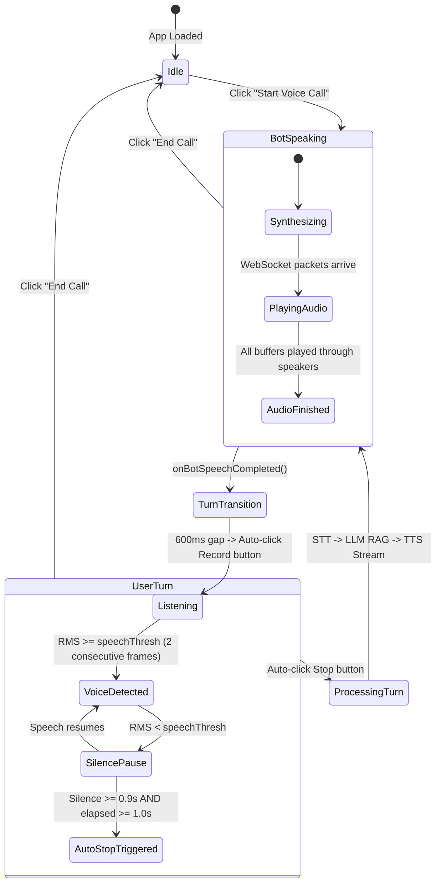

# 📞 Full-Duplex Two-Way Voice Call System: Complete Technical Specification & Architecture

This document provides a comprehensive end-to-end specification of how the **Continuous Two-Way Voice Call** mode works in the **IIIT-NR Academic Assistant**. It details the architectural lifecycle, inter-process communication, client-side Voice Activity Detection (VAD), GPU acceleration pipelines, browser audio scheduling, and critical edge-case guardrails.

---

## 1. System Overview & Conversational Loop

Voice Call Mode operates like an autonomous, full-duplex phone call between the student and the AI assistant:

1. **AI Speaks First**: The assistant greets the user with natural spoken Hindi audio as soon as the call begins.
2. **Hands-Free User Turn**: When the AI finishes speaking, the microphone automatically opens without pressing any buttons.
3. **Auto-Stop VAD**: When the user speaks and then pauses for 0.9 seconds, the system automatically cuts off and submits the recording.
4. **Instant GPU STT**: Whisper Turbo or Meta MMS 1B transcribes the audio in ~300ms.
5. **RAG Retrieval & Answer**: Hybrid search (FAISS + BM25 + RRF) retrieves verified academic guidelines, and Gemini 2.5 Flash streams the answer in natural Hindi with Devanagari number words.
6. **Concurrent GPU TTS**: While the answer tokens are still generating, the Coqui VITS model synthesizes audio sentence-by-sentence on the RTX 4050 GPU and streams it to the browser.
7. **Seamless Repeat**: As soon as the spoken answer finishes playing from the physical speakers, the microphone opens again, repeating the loop indefinitely until the user clicks `🔴 End Call`.

---

## 2. End-to-End Sequence Diagram



---

## 3. Core Architectural Components

### 3.1. Master Top-Window VAD Controller (`parentWin.__iiitnr_vad_controller__`)

Streamlit renders custom HTML components inside sandboxed `<iframe>` tags. Because iframes can be re-mounted and destroyed during Streamlit reruns, the VAD controller is injected directly into `parentWin.document.head`:

- **Singleton AudioContext**: Reuses `parentWin.__iiitnr_vad_audio_ctx__` and `parentWin.__iiitnr_tts_audio_ctx__` to eliminate Chromium's 6-context hardware limit.
- **Persistent MediaStream Source**: Keeps the `AudioNode` graph anchored to the top-level `window` object to prevent browser garbage collection while the audio is streaming.
- **Master Script Self-Updating**: When the Streamlit app reruns, any existing master script element and timers are safely detached and refreshed with zero residual memory leaks.

### 3.2. Browser AudioContext Unlocking (Autoplay Policy)

Modern browsers (Chrome, Edge, Brave) block audio from autoplaying without an explicit user gesture:

- In `VAD_CONTROLLER_HTML_TEMPLATE`, global event listeners (`click`, `touchstart`, `keydown`) are attached to `parentWin.document`.
- When the user clicks `📞 Start Voice Call`, the click handler synchronously resumes both `__iiitnr_tts_audio_ctx__` and `__iiitnr_vad_audio_ctx__`.
- This marks the AudioContexts as **permanently user-activated**, allowing the greeting and all subsequent AI turns to play aloud automatically without being blocked by Chrome's autoplay policies.

### 3.3. TTS Server Packet History Buffer (`TTS/tts_server.py`)

In earlier implementations, if audio chunks were synthesized before the browser iframe established its WebSocket connection, chunks were dropped. The new architecture guarantees 100% packet delivery:

```python
class AudioSession:
    def __init__(self, session_id: str, voice: str = "Female"):
        self.session_id = session_id
        self.voice = voice
        self.websocket: Optional[WebSocket] = None
        self.text_queue: asyncio.Queue = asyncio.Queue()
        self.chunks: List[np.ndarray] = []
        self.is_done = False
        self.packet_history: List[Tuple[str, Any]] = [] # ("text", json) or ("bytes", wav)
        self.packet_event: asyncio.Event = asyncio.Event()
```

- **Ordered History Replay**: Whenever a WebSocket connects (`ws://127.0.0.1:8000/ws_audio/{session_id}`), the server checks `sent_index < len(session.packet_history)`.
- Whether the client connects **before**, **during**, or **after** synthesis has finished, all chunk metadata, audio bytes, and the `done` packet are transmitted in strict sequence.
- **Dual Fallback in Frontend**: The client player receives the `session_id` and also holds a base64 direct audio buffer. If the WebSocket encounters network delay (>1200ms), it automatically falls back to decoding the direct base64 audio buffer without failing.

### 3.4. Sequential Promise Queue Audio Scheduler (`render_streaming_tts_player`)

Web Audio API's `decodeAudioData` is asynchronous. If chunks arrive quickly over WebSocket, decoding them in parallel causes race conditions on `nextStartTime`. The client player uses an ordered Promise chain:

```javascript
let playQueue = Promise.resolve();
let nextStartTime = 0;

function scheduleAudioChunk(arrayBuffer) {
  playQueue = playQueue.then(async () => {
    const ctx = getAudioContext();
    if (ctx.state === 'suspended') await ctx.resume();
    const audioBuffer = await ctx.decodeAudioData(arrayBuffer);
    const source = ctx.createBufferSource();
    source.buffer = audioBuffer;
    source.connect(ctx.destination);

    const startTime = Math.max(ctx.currentTime, nextStartTime);
    source.start(startTime);
    nextStartTime = startTime + audioBuffer.duration;
  });
}
```

When `meta.type === 'done'` arrives, the player waits for `playQueue` to resolve completely, calculates `delayMs = (nextStartTime - ctx.currentTime) * 1000 + 200`, and triggers `onBotSpeechCompleted()` at the exact moment the speaker output ends.

---

## 4. Turn-Taking & Auto-Stop State Machine



### 4.1. Visual UI Feedback States

| State             | Badge Indicator          | Visual Behavior                    | Meaning                                        |
| ----------------- | ------------------------ | ---------------------------------- | ---------------------------------------------- |
| `call_transition` | ⏳ **Purple Glowing Dot** | Pulse animation                    | Bot finished speaking; opening mic in 600ms.   |
| `listening`       | 🟢 **Green Ring Pulse**  | Real-time VU meter                 | Microphone is open; she is actively listening. |
| `speaking`        | 🗣️ **Active Green Bar** | Dynamic VU meter jumps             | User's voice detected; recording audio.        |
| `silence`         | 🟠 **Amber Countdown**   | Bar fills 0% $\to$ 100% | Speech paused; stopping in 0.9s...             |
| `stopping`        | ⏹️ **Purple Solid Bar**  | Bar locked at 100%                 | Auto-stopped; submitting to STT/RAG.           |

---

## 5. Critical Edge Cases & How They Are Solved

### 5.1. Preventing `EncodingError: Unable to decode audio data`

- **Root Cause**: Streamlit's `st.audio_input` uses WaveSurfer and `MediaRecorder`. When a recording stops too quickly (<300ms) or when its audio tracks are muted prematurely, the resulting WebM container lacks complete Opus frames. When Streamlit's internal `convertAudioToWav` (`Ve()`) calls `AudioContext.decodeAudioData()`, Chrome throws `EncodingError: Unable to decode audio data`.
- **Fix 1 (Minimum Duration Guard)**: In `startAnalysis()`, the VAD controller strictly refuses to trigger Stop until `elapsed >= 1500ms`.
- **Fix 2 (Button Disambiguation)**: Streamlit's Stop button has `aria-label="Stop recording"`, which contains the word `"record"`. `getRecordButton()` was updated to strictly exclude buttons with `"stop"`, preventing the recorder from being stopped immediately upon starting.
- **Fix 3 (Single-Click Dispatch)**: Removed redundant synthetic `dispatchEvent` calls that fired duplicate click events on React toggle buttons.
- **Fix 4 (Zero Track Muting)**: The VAD controller no longer sets `track.enabled = false` during `triggerStop()`, allowing `MediaRecorder` to finalize its WebM container cleanly.

### 5.2. Dynamic Key Widget Resetting

- Streamlit's `st.audio_input` component normally caches the previous recording, displaying a trash/clear icon instead of the record button on subsequent turns.
- **Solution**: `st.audio_input` uses a dynamic session key:

  ```python
  key=f"mic_input_{st.session_state.get('audio_input_counter', 0)}"
  ```

  Whenever a voice query is submitted or Call Mode begins, `audio_input_counter` increments by 1. Streamlit re-mounts a pristine widget with the red Record button exposed and ready to receive programmatic clicks.

### 5.3. Out-of-Scope Questions (Refusal Spoken Aloud)

- If a question is out of academic scope, standard RAG systems produce text refusals without audio, breaking the call loop.
- **Solution**: Refusals now synthesize polite spoken Hindi audio via GPU TTS (`refusal_session_id`). The assistant speaks the refusal aloud and hands the turn back to the student so the call remains uninterrupted.

---

## 6. Microservice API Specifications

### 6.1. TTS Microservice (Port 8000)

| Endpoint                 | Method      | Payload / Params                                      | Response                                  | Description                                         |
| ------------------------ | ----------- | ----------------------------------------------------- | ----------------------------------------- | --------------------------------------------------- |
| `/health`                | `GET`       | None                                                  | `{"status": "ready", "cuda": true, ...}`  | GPU engine readiness check.                         |
| `/stream_sentence`       | `POST`      | `{"session_id": str, "text": str, "voice": "Female"}` | `{"status": "queued"}`                    | Sub-millisecond sentence queuing.                   |
| `/stream_finish`         | `POST`      | `{"session_id": str}`                                 | `{"status": "done", "audio_base64": str}` | Signals worker completion and returns complete WAV. |
| `/ws_audio/{session_id}` | `WebSocket` | Binary / JSON streaming                               | Binary WAV chunks + JSON metadata         | High-performance ordered audio packet delivery.     |
| `/synthesize`            | `POST`      | `{"text": str, "voice": "Female"}`                    | `audio/wav` binary                        | Synchronous direct synthesis endpoint.              |

### 6.2. STT Microservice (Port 8001)

| Endpoint      | Method | Payload / Params                             | Response                                                       | Description                                 |
| ------------- | ------ | -------------------------------------------- | -------------------------------------------------------------- | ------------------------------------------- |
| `/health`     | `GET`  | None                                         | `{"status": "ok", "gpu": true}`                                | STT engine readiness check.                 |
| `/transcribe` | `POST` | `?language=auto\|hne\|hi\|en` + Raw WAV body | `{"text": str, "detected_language": str, "inference_ms": int}` | Faster-Whisper / Meta MMS 1B transcription. |

---

## 7. Verification & Runbook Commands

To start and verify the entire system:

```powershell
# 1. Start TTS Service (Port 8000 - RTX 4050 GPU)
Set-Location "d:\iiit nr\sem 5\New folder (2)\uajy-academic-rag-chatbot\TTS"
& "C:\Users\ASUS\anaconda3\envs\minor1\python.exe" tts_server.py

# 2. Start STT Service (Port 8001 - RTX 4050 GPU)
Set-Location "d:\iiit nr\sem 5\New folder (2)\uajy-academic-rag-chatbot\STT\stt-service"
& "C:\Users\ASUS\anaconda3\envs\minor1\python.exe" run.py

# 3. Start Streamlit Frontend (Port 8501)
Set-Location "d:\iiit nr\sem 5\New folder (2)\uajy-academic-rag-chatbot"
& "C:\Users\ASUS\anaconda3\envs\uajy-rag\python.exe" -m streamlit run app/main_streamlit.py

# 4. Run Core Regression Test Suite (480 unit tests)
Set-Location "d:\iiit nr\sem 5\New folder (2)\uajy-academic-rag-chatbot"
& "C:\Users\ASUS\anaconda3\envs\uajy-rag\python.exe" -m pytest tests/ -q
```
